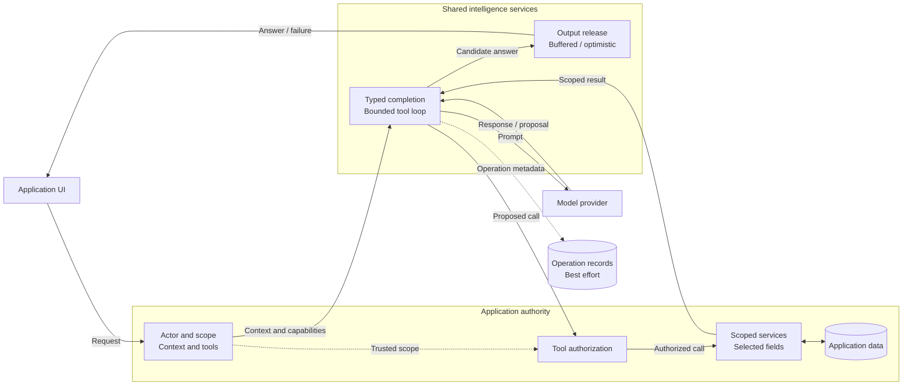

# Building a Permission-Aware Intelligence Layer

**Barry Snyder · Architecture case study · November 2026**

An AI assistant in a business application needs more than a connection to a model. It needs a controlled way to acquire context, request capabilities, handle failure, and produce results that the application can explain. The difficult boundary is between probabilistic interpretation and authoritative application behavior.

This study examines how I approached that boundary through a shared intelligence layer: reusable model execution and structured results, integrated with application-owned identity, permissions, and domain services. The central principle is simple: **the model may propose an operation; application code decides whether and how it runs.**

*Publication note: This is a practitioner synthesis of private implementation work and design discussions. Names, domain concepts, and identifiers have been replaced. The architecture diagram is generalized, and the worked example is fictional. It is not a disclosure of one organization's topology, a production incident report, or a measured security evaluation.*

## 1. Problem, constraints, and my role

The recurring problem was to make intelligence reusable across a business platform. Some features needed a typed classification or recommendation. Others needed conversational help, current application data, and several tool calls. Implementing each as a separate model integration would repeat provider handling, safety configuration, recording, and failure behavior.

The applications already had rules about who could see and do what. Introducing an assistant created another path to those capabilities. A natural-language request could not be allowed to expand the user's authority.

The constraints were consequential:

- **Shared infrastructure, distinct domains.** Applications needed common execution mechanics while retaining their own context, permissions, and business rules.
- **Tenant and resource boundaries.** Knowing a record identifier could not imply permission to retrieve it. Identity and scope had to come from authenticated application state.
- **Untrusted interpretation.** User messages, retrieved content, tool arguments, and model output could be misleading or malicious. Valid JSON alone would not establish correctness or authority.
- **Different interaction needs.** A bounded classification and an interactive assistant did not need the same execution path. A sensitive answer and a low-risk explanation did not necessarily need the same release policy.
- **Operational uncertainty.** Providers, tools, and safety checks could fail independently. Model changes and stale context could alter behavior even when the application code was unchanged.

I designed and implemented shared intelligence services and worked across their application integrations, including .NET services and React/Next.js interfaces. My architectural responsibilities included provider abstractions, typed completion, bounded tool use, safety integration, and operation recording. Application-specific integrations and domain controls were collaborative work.

Here, an **agent** can choose successive tools in pursuit of an objective. An **agentic workflow** constrains that behavior within an application-defined process. Neither term changes the authority of the authenticated user. A straightforward classification can use structured completion without an agent loop at all.

## 2. Architecture



The application assembles context and supplies tool implementations. The shared layer handles execution mechanics; it does not invent tenant identity, grant permissions, or become the owner of domain rules.

The provider boundary matters in both directions. Sending data to a provider is already a disclosure to that service, even if no answer reaches the browser. Context selection and field minimization therefore precede generation. Later output checks cannot repair an over-broad query or take back data already transmitted.

The diagram summarizes responsibility boundaries, not a prescribed deployment layout. A shared layer can be a library inside application services; it need not become another network service.

## 3. Three consequential decisions and their trade-offs

### Decision 1: Share intelligence mechanics; keep context and authority with the application

I separated reusable execution paths from domain integration. A bounded task could request a typed result. A task needing additional observations could use a tool loop with explicit limits. Provider-specific adapters translated requests and responses while common services applied configured checks and recording.

This made intelligence broader than a chat interface. A product could consume a structured result through its existing UI, or expose an assistant using the same underlying services.

A separate decision-provider path supported answers such as a probability, choice, or score. Deterministic application policy then mapped those answers into outcomes. That kept model judgment separate from policy enforcement; a numeric output did not, by itself, establish calibrated confidence.

**The trade-off:** centralization reduces repeated integration work, but creates an abstraction that must accommodate real provider differences. Structured-output support, streaming, errors, and safety behavior do not become identical because they share an interface. Interchangeable adapters also do not imply automatic provider failover; the inspected generation path did not establish that capability.

Application teams still have work to do: select relevant context, project appropriate fields, define tools, and decide what a result means. A shared wrapper cannot infer those responsibilities safely. Likewise, a schema-compatible answer is a candidate application value, not proof that the underlying claim is true.

The useful boundary is between reusable execution and domain meaning. Centralizing both would turn the intelligence layer into a second business platform with its own competing rules.

### Decision 2: Filter the tool catalog, then authorize execution independently

One early design correction was to remove user identity from a model-facing function signature. The backend already knew the authenticated user. Asking the model to supply that identity introduced an unnecessary trust decision.

The resulting pattern has two controls. First, the application offers a tool catalog consistent with the caller's permissions. Second, tool handlers independently enforce permission and resource scope when invoking domain services and constructing queries. Resource identifiers proposed by the model remain untrusted input; they do not override the server-established scope.

**The trade-off:** filtering the catalog makes the assistant's available capabilities more relevant, but it introduces another representation that must remain aligned with application policy. Execution checks remain authoritative even if catalog construction is wrong, a call is malformed, or a model proposes an unavailable capability. This is a reason to reuse application authorization semantics rather than invent a prompt-based permission system.

The principle aligns with resource-centered authorization in [NIST SP 800-207](https://csrc.nist.gov/pubs/sp/800/207/final). OWASP's [Excessive Agency guidance](https://genai.owasp.org/llmrisk/llm062025-excessive-agency/) also identifies overly broad tools and permissions as risks. These references support the design principle; they do not certify this implementation.

A remaining limit is important: an attacker may persuade a model to misuse a capability the user legitimately has. Authorization bounds access; it does not establish user intent. For consequential writes, an application needs additional action-specific controls, such as a user-reviewed proposal and reliable duplicate handling. The read-only example below does not demonstrate a safe write workflow.

### Decision 3: Make output release and failure policy explicit

Whole-response checking and immediate token streaming pull in different directions. If a policy requires checking the complete answer before disclosure, the application must hold it until generation and checking finish. Simulating typing afterward changes presentation, not that latency.

The inspected implementation supports two relevant policies:

| Policy | What the user receives | Cost and failure behavior |
|---|---|---|
| **Buffered** | Answer text only after a successful final full-text check. Tool activity can still be displayed. | Adds waiting time. A block, unavailable judge, or final-check timeout withholds the answer. |
| **Optimistic** | Text as it arrives, with subsequent checks and possible retraction. | More responsive. Disallowed text may already have been seen; judge failure can leave an answer marked unverified in the stream result. |

**The trade-off:** responsiveness changes the exposure window and the meaning of failure. Retraction can clean up the interface, but cannot erase a user's memory, a screenshot, or a client-side copy. Buffered release reduces exposure to unchecked text, but its protection still depends on what the judge can detect.

Input judging in the streaming path can run concurrently with generation and tool execution. It therefore cannot be treated as a prerequisite authorization check. Similarly, cancellation requests can stop further work where supported; they do not roll back a completed operation.

This distinction matters for prompt injection. Retrieved text can influence a model without becoming an authorized instruction. OWASP describes this as [indirect prompt injection](https://genai.owasp.org/llmrisk/llm01-prompt-injection/). Content checks help, but permission enforcement and controlled tool behavior must remain effective when a judge misses the attack.

## 4. Worked example: a workspace service-request assistant

*This fictional example reconstructs the pattern. Its tool names, records, output, and failure cases are illustrative; they are not a replay of a customer interaction.*

A user asks: **“Which of my service requests are still waiting on me, and what should I do next?”**

The application establishes an authenticated actor and workspace. The user may read their own requests, but not everyone else's. The model receives a narrow read tool, `list_my_requests`, with a status filter and a capped result limit. It receives no parameter for choosing another actor or workspace.

The model proposes:

```json
{
  "tool": "list_my_requests",
  "arguments": { "status": "waiting_on_requester", "limit": 5 }
}
```

The server validates the arguments, checks the required permission, and queries using its trusted context. Conceptually:

```text
require permission "request.read.own" from authenticated context
validate status and limit
read requests within authenticated workspace and actor scope
return selected fields: reference, status, next step, last update
```

The tool might return a request waiting for a preferred appointment window. The assistant can summarize that next step and link to the existing application screen. It has no tool to select an appointment, send a message, or modify the request. The user completes any action through the application's normal controls.

For this example, the product chooses **buffered** answer release. The UI shows activity while the answer is generated and checked, then displays either the answer or a distinct failure state. This is a design choice for the example, not a claim that every inspected integration used buffered mode.

### Failure handling

These are the example's required failure behaviors, rather than a claim that every inspected execution path already implements them uniformly.

| Failure or adversarial condition | Required behavior in this example |
|---|---|
| Untrusted next-step text instructs the model to retrieve another workspace's requests. | Reject invented tool names or unsupported actor/workspace arguments. Execute valid list calls only within the authenticated scope. The model cannot expand access by changing its request. |
| A required permission is absent, or arguments are invalid. | Reject the call before the domain operation. Do not retry under a broader identity or reinterpret an authorization failure as an empty result set. |
| The data service times out. | Report that current requests could not be retrieved. Do not turn missing evidence into “you have no pending requests.” Any retry must be bounded. |
| The model repeatedly requests tools without completing. | Stop at the configured execution limit. This example requires an explicit incomplete outcome; that terminal behavior must be verified separately from the existence of the limit. A partial answer is not necessarily correct. |
| The output judge blocks the answer, fails, or times out. | Release no generated answer text under the chosen buffered policy. Offer the ordinary request list as a fallback. Do not label an unavailable check as a successful validation. |
| Operation-record storage fails. | Do not imply that a complete audit trail exists. The inspected implementation favors continuity by tolerating recording failures; a workflow requiring durable audit evidence would need a different persistence guarantee. |

The operation record can help correlate execution with its actor, scope, provider, outcome, and usage. It is supporting evidence, not proof that every tool result was correct or every event was durably captured. The application must also decide what content is appropriate to retain and who may read it.

## 5. Evidence, limitations, and lessons

### What supports this account

This study combines source review with contemporaneous design walkthroughs and demonstrations. Those sources establish different things:

| Evidence | What it supports | What it does not establish |
|---|---|---|
| Implementation review | Separate structured-completion and tool-execution services; permission-filtered tool definitions; handler-level access checks; scoped queries; buffering and retraction behavior; recording paths. | Deployment configuration, live performance, or the absence of vulnerabilities. |
| Focused test-source review | Explicit test cases for selected permissions, scope restrictions, and stream-guard failure behavior. | A fresh test run, complete coverage, or an adversarial security evaluation. |
| Design discussions and demonstrations | Authorship and rationale, working application integration, and observed usability problems. | A general success rate, customer adoption, or business-outcome improvement. |

Private source, transcripts, and identifying implementation details are not published. That limits independent verification of this account. The public contribution is the design reasoning and an example readers can implement and challenge in their own systems.

### Where the design remains limited

Demonstrations exposed plausible explanations based on outdated domain context and a legitimate request that appeared to be blocked by a safety check. The exact blocking cause was not established in that demonstration. These observations separate **access correctness**, **answer correctness**, and **usability**: improving one does not automatically improve the others.

Other limits remain material. Sensitive-data controls require coverage review: which patterns they recognize, which outgoing content paths they inspect, and which fields applications exclude before generation. “PII scanning” alone is not evidence of complete data-loss prevention. Recording was best effort, not an assured ledger. A curated evaluation dataset and model-change regression process were discussed, but the reviewed evidence did not establish a completed evaluation program.

A useful next evaluation would vary user permissions, tenant scope, benign and injected content, provider failures, judge failures, and model versions. It should separately measure unauthorized data exposure, incorrect tool selection, unsupported answers, false blocks, completion rate, and response latency. Those are proposed measurements, not results reported here.

### Lessons I carry forward

1. **Put identity in trusted execution context.** A model should not have to choose who it is acting as when the application already knows.
2. **Make the ordinary integration path carry the controls.** Shared execution services reduce omissions, while configuration and bypasses still deserve review.
3. **Choose the smallest execution model that fits.** Typed completion is often sufficient; tool-driven agents need additional bounds and failure states.
4. **Specify when information leaves each boundary.** Provider disclosure, browser delivery, and durable recording are different events with different guarantees.
5. **Keep capability, correctness, and adoption separate.** A reusable architecture is useful infrastructure. Demonstrating that it reliably helps people requires its own evidence.

---

[Back to my profile](../README.md)
